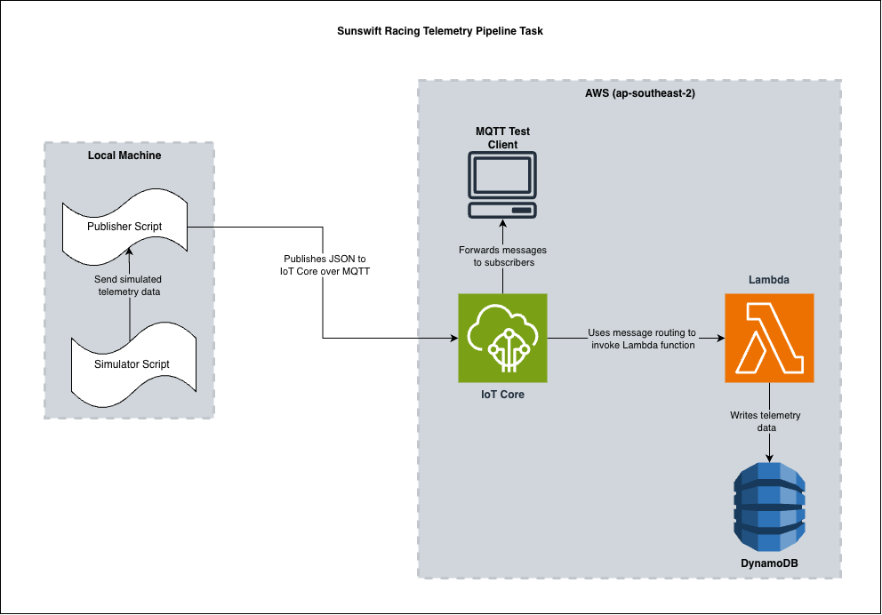

# Sunswift Racing Telemetry Pipeline Task

A telemetry pipeline that sends simulated car data to **AWS IoT Core** over MQTT and stores each reading in **Amazon DynamoDB**.

Built for the Sunswift Racing telemetry task.

## The task
Design and build a telemetry pipeline that includes AWS IoT Core:
- A script publishes JSON packets to IoT Core.
- A mechanism of my choosing writes the data from each packet into a database of my choosing.

The packet format, database and table layout were left open.

## Why a pipeline like this
Telemetry is how a team sees what the car is doing in real time: speed, motor temperature, battery state of charge, GPS position. Engineers use it to analyse performance, diagnose faults and plan race strategy. To be useful, it has to:
- get off the car reliably, over a link that may drop out
- be stored in a form that's easy to query later, for example "motor temperature over the last lap"

There is no real car here, so a simulator stands in for the car's embedded system.

## Architecture



1. **`simulator.py`** produces one snapshot of readings per tick. It's a Python generator, so its values carry over between ticks and drift smoothly.
2. **`publish.py`** wraps each snapshot in a packet with metadata. It publishes the packet to IoT Core over **MQTT** (mutual TLS with an X.509 certificate, QoS 1), on topic `sr8/telemetry/test`.
3. **IoT Core** sends a copy to any subscribers, such as the **MQTT test client**, which is used for viewing only. Its **rules engine** matches `SELECT * FROM 'sr8/telemetry/#'` and invokes the Lambda.
4. **The Lambda** ([`lambda/lambda_function.py`](lambda/lambda_function.py)) splits the packet into **one row per reading** and writes them to DynamoDB in one `BatchWriteItem` request.

## Packet format
This is the contract between the car and the cloud. `publish.py` and the Lambda must agree on these field names.

```json
{
  "source": "SR8-Telemetry",
  "vehicle": "SR8 Tribrid",
  "sequence_id": 42,
  "timestamp": "2026-11-09T07:04:23.183+00:00",
  "data": {
    "/car/speed/gps": 43.93,
    "/car/odometer": 52,
    "/car/brake/pressed": false,
    "/car/drive_mode": "DRIVE",
    "/car/bms/cell/1/current_shunting": true
  }
}
```

| Field | Purpose |
|---|---|
| `sequence_id` | Increases by 1 per packet, so a gap reveals a lost packet. It restarts at 1 on every run. |
| `timestamp` | UTC time when the car took the readings, set **on the car**, not in the cloud. |
| `data` | Readings keyed by endpoint path. One packet currently holds 23 readings. |

## Database design
DynamoDB table `sr8-telemetry`:

| Attribute | Type | Notes |
|---|---|---|
| `measure_name` | String | **Partition key**, e.g. `/car/motors/rpm/left` |
| `time` | String | **Sort key**: an ISO 8601 UTC timestamp, so sorting as text matches sorting by time |
| `value` | Number / Boolean / String | The reading, stored in its native type |
| `value_type` | String | `double`, `bigint`, `boolean` or `varchar` |
| `source`, `vehicle`, `sequence_id` | | Copied from the packet |

Example rows (one packet):

| measure_name | time | value | value_type | sequence_id |
|---|---|---|---|---|
| /car/speed/gps | 2026-11-09T07:04:23.183+00:00 | 43.93 | double | 3 |
| /car/odometer | 2026-11-09T07:04:23.183+00:00 | 52 | bigint | 3 |
| /car/brake/pressed | 2026-11-09T07:04:23.183+00:00 | false | boolean | 3 |
| /car/drive_mode | 2026-11-09T07:04:23.183+00:00 | DRIVE | varchar | 3 |

## Design decisions

**Database: DynamoDB.**
- It's serverless and costs nothing at this scale, with on-demand billing.
- Amazon Timestream, a purpose-built time-series database, isn't open to new customers.
- A relational database such as RDS would need VPC networking and a server running all the time.

**Keys: `measure_name` + `time`.** Telemetry is usually read as one signal over a time range, for example to plot speed during a lap. With these keys that's a single DynamoDB `Query`, not a scan of the whole table.

**Processing: IoT rule → Lambda, not the rule's built-in DynamoDB action.**
- The car sends many readings in one packet, which saves bandwidth and messages.
- The rules engine can't split one packet into many rows, so a Lambda does it.
- The Lambda also records each value's type and converts floats to `Decimal`, as boto3 requires.

**Typed values.** DynamoDB is schemaless, so one `value` attribute can hold any type. Instead of separate columns per type (as in Timestream), `value_type` records the type explicitly.

**The timestamp comes from the car.**
- IoT Core invokes the Lambda asynchronously, so packets can be processed out of order, and possibly in parallel.
- Each row records when the reading was *taken*, not when the Lambda processed it, so the stored data stays correct.

**MQTT with QoS 1.**
- A single connection stays open for the whole run, with only a few bytes of overhead per message.
- The broker acknowledges each packet.
- Publish/subscribe means new consumers (a live dashboard, alerts) can subscribe without changing the car.

**Least-privilege security.**
- **Device:** the certificate proves the car's identity. Its IoT policy only allows connecting as `sr8-simulator` and publishing to `sr8/telemetry/*`.
- **Rule:** only this rule may invoke the Lambda.
- **Lambda:** its role may only write to the one table.

**The simulator is separate from the publisher.**
- The simulator gives random but plausible values that drift within realistic ranges. The task is about moving data, so the values aren't modelled on real car behaviour.
- Swapping in real car data would only change `simulator.py`.

## Repository structure
```
publish.py                  connects to IoT Core and publishes packets
simulator.py                generates simulated readings
lambda/lambda_function.py   splits each packet into DynamoDB rows
docs/architecture.png       architecture diagram
requirements.txt
```

## Setup
**Prerequisites:** Python 3.13+, an AWS account, and the AWS console set to one region (this project used `ap-southeast-2`).

### AWS (console)
1. **DynamoDB:** create table `sr8-telemetry` with partition key `measure_name` (String) and sort key `time` (String), on-demand capacity.
2. **Lambda:** create a Python 3.13 function (e.g. `sr8-telemetry-write`) and paste in [`lambda/lambda_function.py`](lambda/lambda_function.py). Then add an inline policy to its role:
   ```json
   {"Version": "2012-10-17", "Statement": [{"Effect": "Allow",
     "Action": ["dynamodb:PutItem", "dynamodb:BatchWriteItem"],
     "Resource": "arn:aws:dynamodb:<region>:<account-id>:table/sr8-telemetry"}]}
   ```
3. **IoT policy:** create a policy that allows only what the car needs:
   ```json
   {"Version": "2012-10-17", "Statement": [
     {"Effect": "Allow", "Action": "iot:Connect", "Resource": "arn:aws:iot:<region>:<account-id>:client/sr8-simulator"},
     {"Effect": "Allow", "Action": "iot:Publish", "Resource": "arn:aws:iot:<region>:<account-id>:topic/sr8/telemetry/*"}]}
   ```
4. **Thing and certificate:** create Thing `sr8-simulator` with an auto-generated certificate, and attach the policy. Download the files into `certs/` with these names:
   - device certificate → `device.pem.crt`
   - private key → `private.pem.key`
   - Amazon Root CA 1 → `AmazonRootCA1.pem`
5. **Rule:** create an IoT rule with `SELECT * FROM 'sr8/telemetry/#'` and a Lambda action pointing at the function. The console grants IoT Core permission to invoke the Lambda.

### Local
```bash
python -m venv .venv && source .venv/bin/activate
pip install -r requirements.txt
echo 'IOT_ENDPOINT=<your endpoint>' > .env    # from IoT Core → Settings → Device data endpoint
```
`certs/` and `.env` are gitignored and must never be committed.

### Run and check it works
1. In the AWS console, open **IoT Core → MQTT test client** and subscribe to `sr8/telemetry/#`.
2. Run `python publish.py`. It publishes 3 packets, 1 second apart.
3. Each packet should appear in the test client.
4. Each packet adds 23 rows in **DynamoDB → Explore items → `sr8-telemetry`**.
5. To watch the Lambda's logs live: `aws logs tail /aws/lambda/sr8-telemetry-write --follow`

On macOS, the first connection may ask for your **Mac login password** so Python can use the key in the Keychain. Choose *Always Allow*.

## Limitations and next steps
- **Same-millisecond collisions:** two packets stamped in the same millisecond would overwrite each other's rows. That can't happen at 1 Hz from one car, but supporting several cars would need the vehicle in the partition key (e.g. `SR8#/car/speed/gps`).
- **No failure handling:** failed Lambda invocations are only logged. A dead-letter queue would keep failed packets for replay.
- **Manual setup:** infrastructure-as-code (CloudFormation, CDK or Terraform) would make the AWS setup reproducible.
- **No reconnection or local buffering:** a real car would need to reconnect and buffer data while offline.
